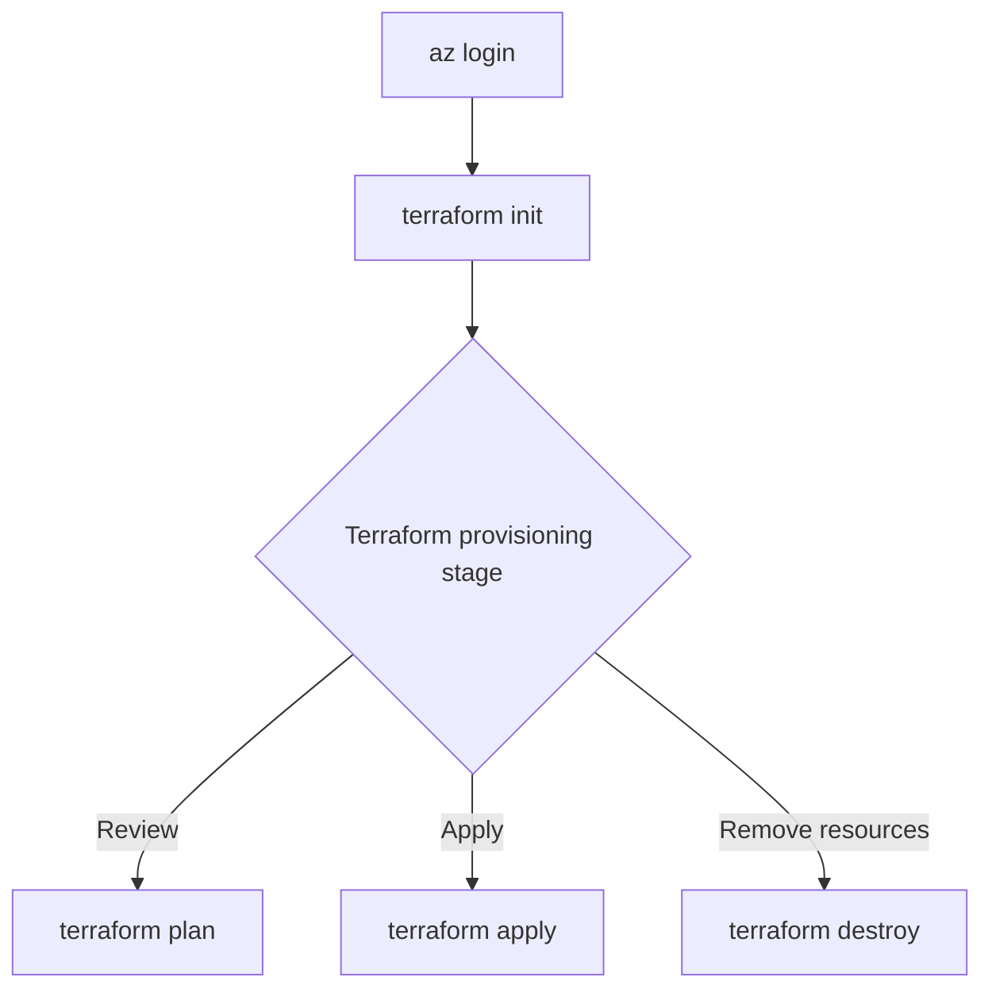

# Terraform Deployment Template

Use the Terraform template in this repository to provision the Azure resources
for the PDF invoice-processing solution.

!!! warning "Review values before applying"
    The supplied `terraform.tfvars` is a demo configuration. Review resource
    names, regions, subscription constraints, access requirements, and any
    values that are specific to your environment before applying it.

## Template files

| File | Purpose |
| --- | --- |
| [main.tf](https://github.com/Cloud2BR-MSFTLearningHub/PDFs-Invoice-Processing-Fapp-OpenFramework/blob/main/terraform-infrastructure/main.tf) | Defines the infrastructure resources and their relationships. |
| [variables.tf](https://github.com/Cloud2BR-MSFTLearningHub/PDFs-Invoice-Processing-Fapp-OpenFramework/blob/main/terraform-infrastructure/variables.tf) | Declares configurable template inputs. |
| [terraform.tfvars](https://github.com/Cloud2BR-MSFTLearningHub/PDFs-Invoice-Processing-Fapp-OpenFramework/blob/main/terraform-infrastructure/terraform.tfvars) | Provides the demo deployment values to adapt for your environment. |
| [provider.tf](https://github.com/Cloud2BR-MSFTLearningHub/PDFs-Invoice-Processing-Fapp-OpenFramework/blob/main/terraform-infrastructure/provider.tf) | Configures Terraform providers. |
| [outputs.tf](https://github.com/Cloud2BR-MSFTLearningHub/PDFs-Invoice-Processing-Fapp-OpenFramework/blob/main/terraform-infrastructure/outputs.tf) | Exposes created resource and application details. |

## Deployment flow

## Deploy

1. Review and update the [Terraform variable template](https://github.com/Cloud2BR-MSFTLearningHub/PDFs-Invoice-Processing-Fapp-OpenFramework/blob/main/terraform-infrastructure/terraform.tfvars).
2. Sign in with `az login` and select the target subscription.
3. Run `terraform init`, then review `terraform plan -var-file terraform.tfvars`.
4. Apply the approved plan with `terraform apply -var-file terraform.tfvars`.

For prerequisites, screenshots, and the complete provisioning procedure, see
the [Terraform deployment guide](https://github.com/Cloud2BR-MSFTLearningHub/PDFs-Invoice-Processing-Fapp-OpenFramework/blob/main/terraform-infrastructure/README.md).